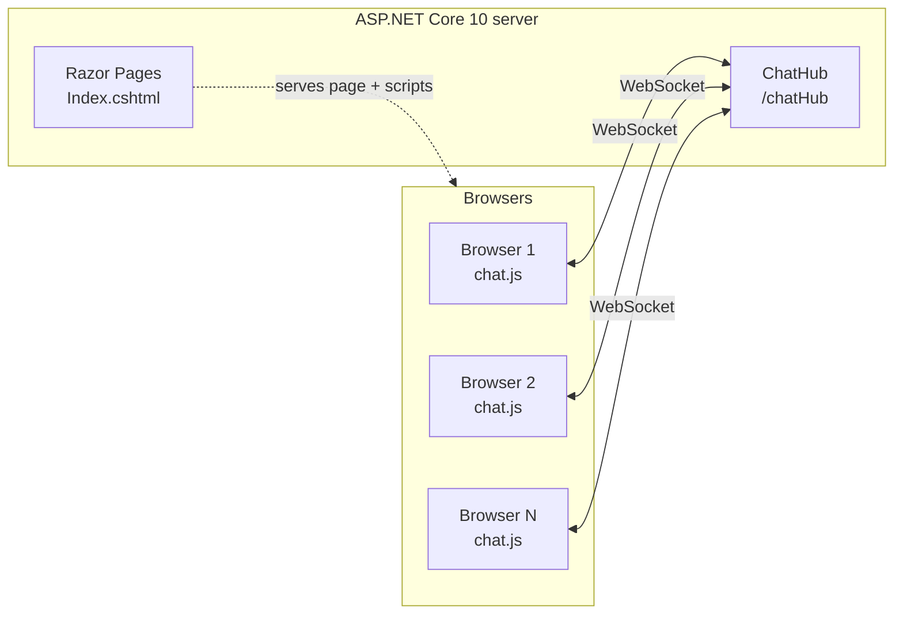
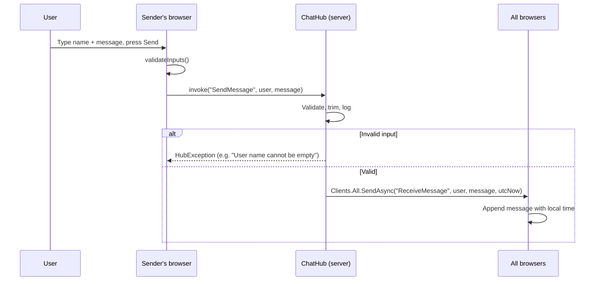

# WebAppSignalR

A real-time chat application built with **ASP.NET Core 10** and **SignalR**. Every message a user sends is pushed instantly to everyone who has the page open, with no page refresh.

The project is a learning resource: a small, readable codebase that shows SignalR basics such as hub methods, broadcasting, connection lifecycle events, automatic reconnection and input validation on both client and server.

> Looking for ways to turn this into a real product? See [IDEAS.md](IDEAS.md) (Arabic).

---

## Contents

- [Features](#features)
- [Tech stack](#tech-stack)
- [Getting started](#getting-started)
- [How it works](#how-it-works)
- [Configuration](#configuration)
- [Project structure](#project-structure)
- [Current limitations](#current-limitations)
- [Updating the SignalR client](#updating-the-signalr-client)
- [References](#references)

---

## Features

- **Real-time broadcast:** messages reach every connected browser immediately over WebSockets.
- **Validation on both sides:** the browser checks input for fast feedback, and the hub enforces the same rules because client checks can be bypassed.
- **Automatic reconnection:** after a network drop, the client retries at 0, 0, 3, 5, 10, 15 and 30 seconds.
- **Connection status:** the page shows *Connected*, *Reconnecting...* or *Disconnected*, and disables Send while offline.
- **XSS-safe rendering:** messages are inserted with `textContent`, so HTML in a message is shown as text.
- **Timestamps:** the server stamps each message in UTC, and the browser shows it in local time.
- **Logging:** connects, disconnects and messages are logged through `ILogger`.
- **Accessibility basics:** labelled inputs, ARIA attributes, and an `aria-live` region for new messages.
- **Enter to send:** pressing Enter in the message box sends the message.

---

## Tech stack

| Layer | Technology | Version |
|---|---|---|
| Runtime | .NET | 10.0 (`net10.0`) |
| Web framework | ASP.NET Core Razor Pages | 10.0 |
| Real-time server | ASP.NET Core SignalR | 10.0 (part of the shared framework, no NuGet package) |
| Real-time client | `@microsoft/signalr` | 10.0.11 (pinned in `libman.json`) |
| Styling | Bootstrap | 4.3.1 |
| Scripts | jQuery | 3.3.1 (used by the layout and validation scripts) |
| Client library manager | LibMan | `libman.json`, jsDelivr provider |

---

## Getting started

### Prerequisites

- [.NET 10 SDK](https://dotnet.microsoft.com/download/dotnet/10.0)
- A trusted HTTPS development certificate: `dotnet dev-certs https --trust`
- Visual Studio 2026, VS Code or any editor

### Run

```bash
cd WebAppSignalR
dotnet run
```

Then open **https://localhost:5001** (or **http://localhost:5000**). The ports come from [launchSettings.json](WebAppSignalR/Properties/launchSettings.json).

### Try it

1. Open the site in two or more browser tabs.
2. Wait until the status says **Connected**.
3. Enter a name and a message in one tab, then click **Send Message** or press Enter.
4. The message appears in every tab at the same time.

More manual test scenarios (reconnection, validation, XSS) are in [QUICK_START.md](WebAppSignalR/QUICK_START.md).

---

## How it works

### Architecture



SignalR picks the best transport each browser supports: **WebSockets** first, then **Server-Sent Events**, then **Long Polling**.

### Sending a message



### Server: the hub

[ChatHub.cs](WebAppSignalR/Hubs/ChatHub.cs) has one method that clients call:

```csharp
public async Task SendMessage(string user, string message)
{
    if (string.IsNullOrWhiteSpace(user))
        throw new HubException("User name cannot be empty");
    if (string.IsNullOrWhiteSpace(message))
        throw new HubException("Message cannot be empty");

    user = user.Trim();
    message = message.Trim();

    if (user.Length > 50)
        throw new HubException("User name is too long (max 50 characters)");
    if (message.Length > 1000)
        throw new HubException("Message is too long (max 1000 characters)");

    _logger.LogInformation("Message from {User}: {Message}", user, message);
    await Clients.All.SendAsync("ReceiveMessage", user, message, DateTime.UtcNow);
}
```

It also overrides `OnConnectedAsync` and `OnDisconnectedAsync` to log each connection.

### Client: the connection

[Chat.js](WebAppSignalR/wwwroot/js/Chat.js) builds the connection, listens for messages and tracks connection state:

```javascript
const connection = new signalR.HubConnectionBuilder()
    .withUrl("/chatHub")
    .withAutomaticReconnect([0, 0, 3000, 5000, 10000, 15000, 30000])
    .withHubProtocol(new signalR.JsonHubProtocol())
    .build();

connection.on("ReceiveMessage", (user, message, timestamp) => { /* append to list */ });

connection.onreconnecting(() => { /* show "Reconnecting...", disable Send */ });
connection.onreconnected(() => { /* show "Connected", enable Send */ });
connection.onclose(() => { /* show "Disconnected" */ });
```

### Validation rules

| Field | Rule | Checked in browser | Checked on server |
|---|---|---|---|
| User name | Required, at most 50 characters | Yes | Yes (after trimming) |
| Message | Required, at most 1000 characters | Yes | Yes (after trimming) |
| Whole SignalR message | At most 32 KB | No | Yes (`MaximumReceiveMessageSize`) |

---

## Configuration

All configuration is in [Program.cs](WebAppSignalR/Program.cs).

```csharp
builder.Services.AddSignalR(options =>
{
    options.MaximumReceiveMessageSize = 32 * 1024;            // reject oversized messages
    options.KeepAliveInterval = TimeSpan.FromSeconds(15);     // server ping interval
    options.ClientTimeoutInterval = TimeSpan.FromSeconds(30); // drop silent clients
});

app.MapHub<ChatHub>("/chatHub");
```

**CORS** is currently open to any origin, header and method. That is convenient for local experiments but should be restricted to known origins before deploying.

---

## Project structure

```text
WebAppSignalR/                     repository root
├── README.md                      this file
├── IDEAS.md                       product ideas built on SignalR (Arabic)
├── WebAppSignalR.sln
└── WebAppSignalR/
    ├── Hubs/
    │   └── ChatHub.cs             SignalR hub: validation, broadcast, logging
    ├── Pages/
    │   ├── Index.cshtml           chat UI
    │   ├── Error.cshtml, Privacy.cshtml
    │   └── Shared/_Layout.cshtml  layout with Bootstrap and jQuery
    ├── Properties/
    │   └── launchSettings.json    local ports and environment
    ├── wwwroot/
    │   ├── js/
    │   │   ├── Chat.js            SignalR client logic
    │   │   └── signalr/dist/browser/
    │   │       ├── signalr.js     SignalR client 10.0.11
    │   │       └── signalr.min.js
    │   ├── lib/                   Bootstrap, jQuery, jQuery Validation
    │   └── css/site.css
    ├── Program.cs                 services, SignalR options, middleware
    ├── libman.json                client library versions
    ├── QUICK_START.md             manual test guide
    └── WebAppSignalR.csproj       targets net10.0
```

---

## Current limitations

This is a demo, not a production chat. Before using it for real:

- **No authentication.** Anyone can type any name.
- **No persistence.** Messages exist only in open browsers and disappear on refresh. Messages sent while a client is reconnecting are not delivered to it.
- **One room.** Every message goes to every client (`Clients.All`). Rooms would use SignalR groups.
- **Open CORS policy.** Restrict it to your own origins.
- **Single server.** Running more than one instance needs a backplane such as Redis or Azure SignalR Service.

---

## Updating the SignalR client

The browser library is managed by LibMan and pinned to an exact version in [libman.json](WebAppSignalR/libman.json). Keep it on the same major version as the server (.NET 10, so `10.x`).

```bash
dotnet tool install -g Microsoft.Web.LibraryManager.Cli   # once
cd WebAppSignalR
# edit the version in libman.json, then:
libman restore
```

The `jsdelivr` provider is used because LibMan's `unpkg` provider failed to resolve recent versions.

---

## References

- [ASP.NET Core SignalR overview](https://learn.microsoft.com/aspnet/core/signalr/introduction)
- [SignalR hubs](https://learn.microsoft.com/aspnet/core/signalr/hubs)
- [SignalR JavaScript client](https://learn.microsoft.com/aspnet/core/signalr/javascript-client)
- [SignalR configuration](https://learn.microsoft.com/aspnet/core/signalr/configuration)
- [SignalR security considerations](https://learn.microsoft.com/aspnet/core/signalr/security)
- [Scale out with Redis](https://learn.microsoft.com/aspnet/core/signalr/redis-backplane)
- [OWASP: Cross-Site Scripting](https://owasp.org/www-community/attacks/xss/)

---

## License

Provided as a learning resource.
